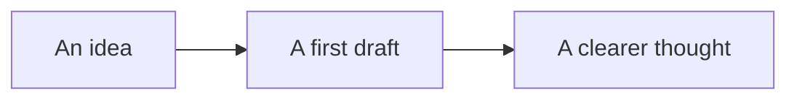

# A place for your thoughts

Keep your mind on the words. **Typora** brings reading and writing together in a clean, quiet space.

## Write naturally

Use **bold**, *emphasis*, ~~strikethrough~~, and `inline code`. Follow a [link](https://typora.io) or keep a thought in a footnote.[^note]

> The details disappear. Your ideas stay in focus.

### Make a little progress

- [x] Find a quiet place
- [x] Put the first words on the page
- [ ] Follow the next idea

1. Start with a question.
2. Explore what you know.
3. Leave room for discovery.

## Bring structure to ideas

| Feature | Markdown | Result |
| :--- | :---: | ---: |
| Headings | `##` | Clear structure |
| Tasks | `- [ ]` | Small steps |
| Tables | `|` | A simple comparison |

### A small piece of code

```javascript
function welcome(name) {
  return `A blank page, ${name}. A new beginning.`;
}
console.log(welcome('world'));
```

### Mathematics

The relation $e^{i\pi} + 1 = 0$ connects five familiar constants.

$$
\int_0^1 x^2\,dx = \frac{1}{3}
$$

### Connected thoughts



---

## 中文写作

让文字保持清楚，让思路自然展开。中文输入、标点和换行都应保留。

[^note]: Some thoughts belong in the margin.
