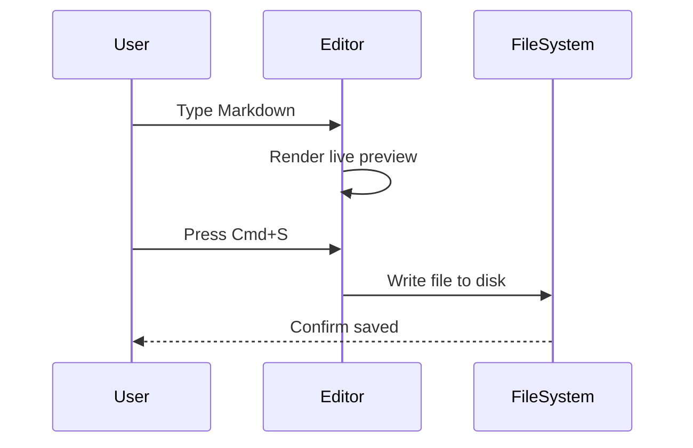

# Markdown Feature Stress Test

This file packs the renderer's hardest cases into one document. It is not meant to read well — it is meant to break things, so every construct below should survive a round trip through the editor.

## Heading Levels

# Level One
## Level Two
### Level Three
#### Level Four
##### Level Five
###### Level Six

## Lists

### Nested Unordered, Three Levels

- Fruit
  - Citrus
    - Orange
    - Lemon
- Vegetables
  - Roots
    - Carrot
    - Parsnip

### Tasks Nested One Level

- Ship release 1.0
  - [x] Write the changelog
  - [x] Tag the commit
  - [ ] Upload the build
  - [ ] Announce it on the blog

## Tables

### Wide Table, Six Columns

| ID  | Name   | Role       | Team      | Location  | Status   |
| --- | ------ | ---------- | --------- | --------- | -------- |
| 001 | Ada    | Engineer   | Core      | London    | Active   |
| 002 | Grace  | Compiler   | Toolchain | Arlington | Active   |
| 003 | Alan   | Theory     | Research  | Princeton | Archived |
| 004 | Edsger | Algorithms | Research  | Nuenen    | Archived |

### Column Alignment

| Left Aligned | Centered | Right Aligned |
| :----------- | :------: | ------------: |
| alpha        |   one    |          1.00 |
| beta         |   two    |         20.50 |
| gamma        |  three   |        300.99 |

## Code

```typescript
interface EditorState {
  path: string;
  dirty: boolean;
  words: number;
}

export function markSaved(state: EditorState): EditorState {
  return { ...state, dirty: false };
}
```

```css
.markdown-body h1 {
  font-size: 2em;
  border-bottom: 1px solid #eaecef;
}

.markdown-body code {
  padding: 0.2em 0.4em;
  border-radius: 3px;
  background: rgba(27, 31, 35, 0.06);
}
```

## Math

Display math with sums and fractions should typeset cleanly:

$$
\sum_{k=1}^{n} k = \frac{n(n+1)}{2}
$$

## Sequence Diagram



## Blockquote Containing a List

> Release checklist:
>
> - Tests pass on macOS
> - Documentation is updated
> - Version number is bumped
>
> Then, and only then, ship it.

## Inline Edge Cases

A footnote[^stress] for the parser to chase. A [link with a title](https://typora.io "Typora homepage"), an autolink <https://example.com>, and a raw URL https://example.com should all become clickable. ==highlight== sits next to ~~strike~~, and a literal :smile: stays exactly as typed.

This line ends with two trailing spaces.  
so the next line must render as a hard break, while an escaped \*star\* must stay literal and never open emphasis.

[^stress]: Even under stress, the footnote definition still lands at the bottom of the document with a working backlink.
