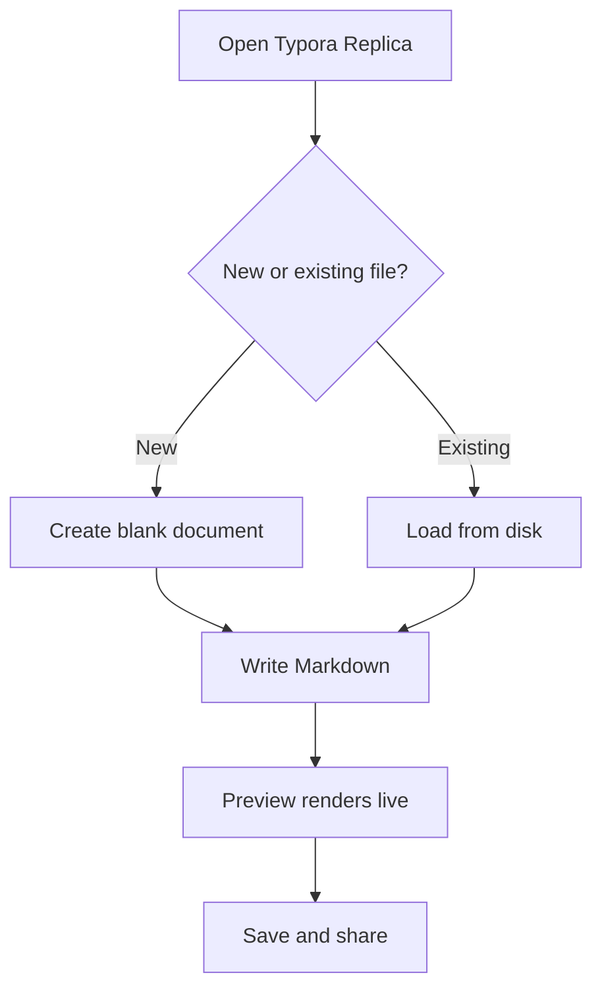

# Welcome to Typora Replica

Thanks for trying Typora Replica, a distraction-free Markdown editor for macOS. This document doubles as a feature tour, and it already shows off **bold text**, *italic text*, ~~strikethrough~~, `inline code`, ==highlighted passages==, and a [link to the original Typora](https://typora.io) that inspired this project. You can even write chemistry like H~2~O or math like X^2^ without ever leaving the keyboard.

## Getting Started

Typora Replica renders Markdown as you type, so there is no separate preview pane competing for your attention. What you are reading right now is the editor's built-in sample document — feel free to edit it, break it, and watch the rendering follow along in real time.

### Core Editing

Use the sections below to try the editor's Markdown styles and keyboard commands.

#### Inline Formatting

Use the menu bar, the keyboard shortcuts, or simply type the Markdown syntax yourself. Live rendering hides the markup as soon as your cursor moves away, so the document always reads the way it will print.

#### Things to Try First

- Type `**` around a word and watch it turn bold live
- Press `Cmd+K` to insert a link
- Start any line with `# ` to promote it to a heading
- Use Format → Image to insert an image path or URL

### Your First Document

1. Create a new file with `Cmd+N`
2. Write a heading and a short paragraph
3. Save anywhere on disk with `Cmd+S`
4. Reopen the file and keep writing

### Today's Checklist

- [x] Open the welcome document
- [x] Watch a heading render live
- [ ] Write your own first paragraph
- [ ] Render a math block
- [ ] Check off every item in this list

---

## Quotes Worth Keeping

> Good tools stay out of the way. A Markdown editor should feel like paper: you think about the words, not the markup that produces them.
>
> That is the idea behind live rendering — the syntax fades the moment you finish typing it, and what remains is simply the document.

## Code

Fenced code blocks get syntax highlighting out of the box. Here is a small JavaScript example:

```javascript
const editor = document.querySelector('.cm-content');

function countWords(text) {
  return text
    .trim()
    .split(/\s+/)
    .filter(Boolean)
    .length;
}

const words = countWords(editor.textContent);
console.log(`This document has ${words} words.`);
```

And the same idea, a little terser, in Python:

```python
def count_words(text: str) -> int:
    return len([w for w in text.split() if w.strip()])

words = count_words("The quick brown fox jumps over the lazy dog.")
print(f"This document has {words} words.")
```

## Keyboard Shortcuts

| Action         | Shortcut | Menu Path       | Notes                 |
| -------------- | -------- | --------------- | --------------------- |
| Bold           | Cmd+B    | Format → Bold   | Toggles the selection |
| Italic         | Cmd+I    | Format → Italic | Toggles the selection |
| Insert Link    | Cmd+K    | Format → Link   | Opens the link dialog |
| Toggle Source  | Cmd+/    | View → Source   | Shows raw Markdown    |
| Save File      | Cmd+S    | File → Save     | Writes to disk        |

## Mathematics

Inline math works inside any paragraph — Euler's identity $e^{i\pi}+1=0$ is the classic example — while display math gets its own centered block, such as the quadratic formula:

$$
x = \frac{-b \pm \sqrt{b^2 - 4ac}}{2a}
$$

## Diagrams

Mermaid diagrams render inline, so a flowchart can live right next to the paragraph that explains it:



## Images

Images referenced with relative paths resolve next to the document, which keeps projects portable:


## 中文排版

测试中文输入与排版，确认字体回退正常。中西文混排时应保持一致的基线与行高，标点符号使用全角形式。

## Footnotes

Footnotes let you add side notes[^1] without interrupting the flow of the main text, and each note links back to the place it was referenced.[^2]

[^1]: This is the first footnote. Definitions collect at the bottom of the document no matter where the reference appears.
[^2]: The second footnote works the same way, with a backlink to its reference in the text above.
